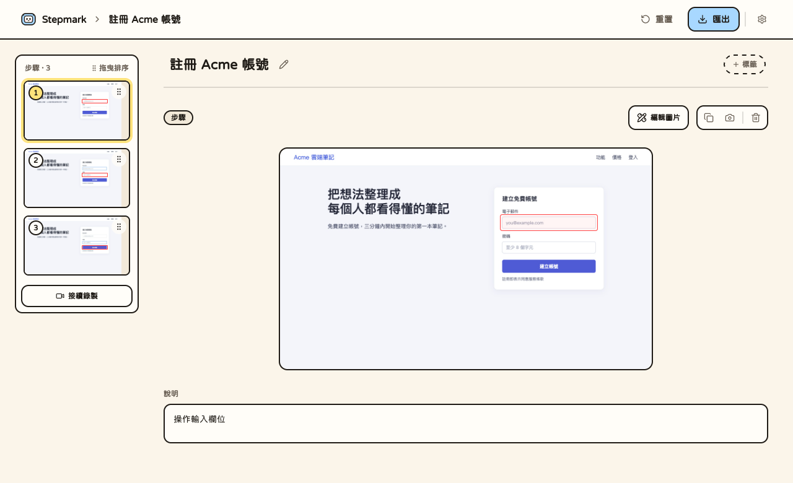
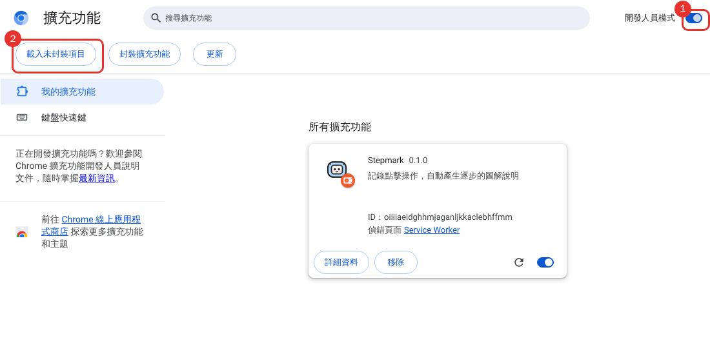
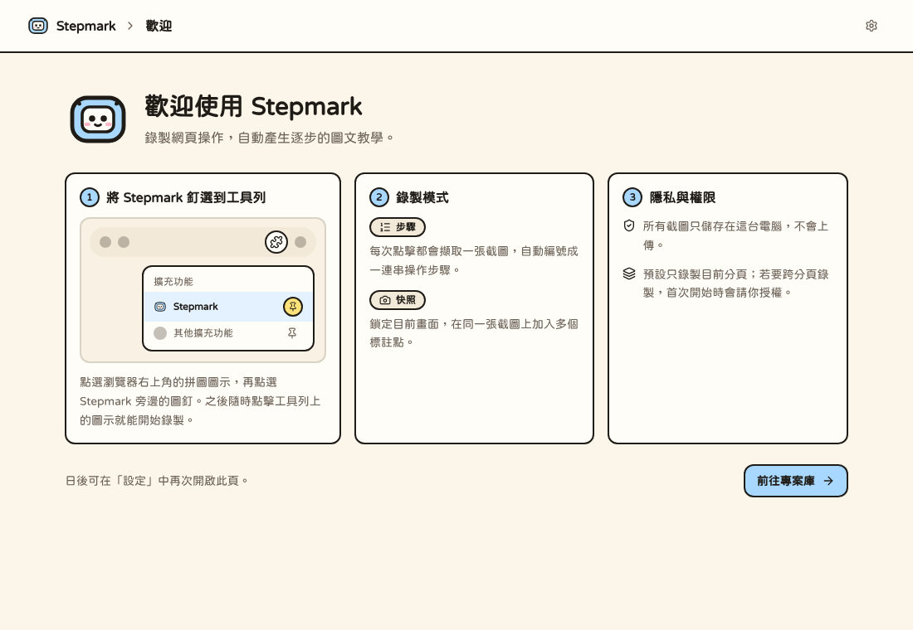
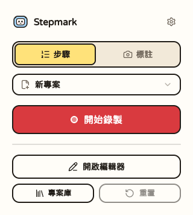
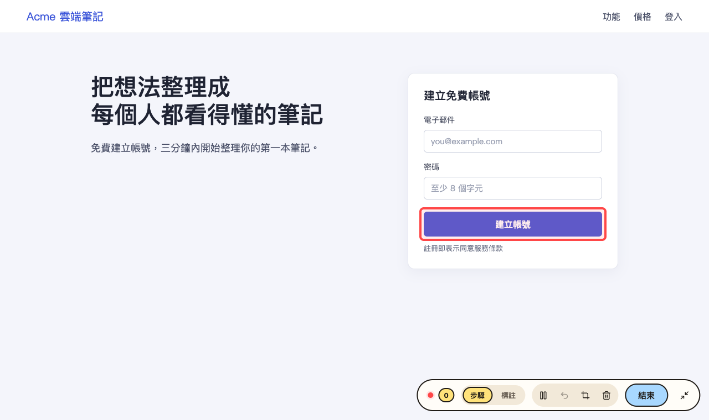
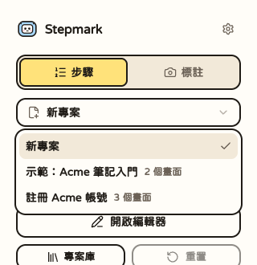
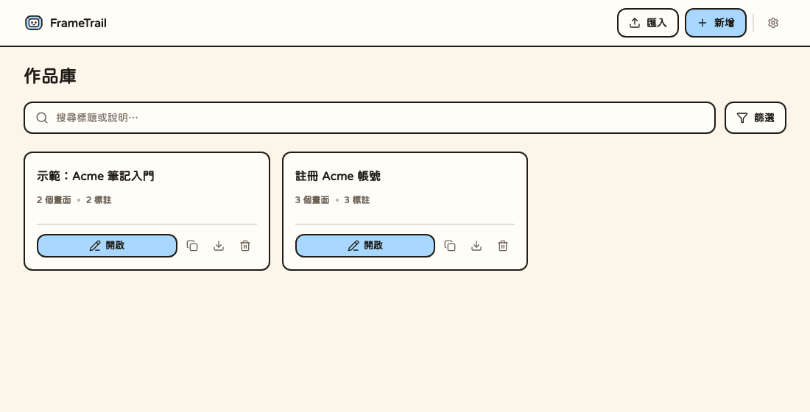

# Stepmark

在瀏覽器裡「點一點、錄一錄」，自動把網頁操作變成一步一步的圖文教學。

每個步驟都會有截圖、紅框標註和可以自己改的說明文字。做好的專案可以匯出成 **PDF、HTML 網頁、Markdown 或圖片**。所有資料都只存在你自己的電腦裡，不需要帳號，也不會上傳到任何地方。



> **目前還沒有上架到瀏覽器商店。**
> 請照下面的「安裝」自己建置一次，大約 5 分鐘，之後就能像一般擴充功能一樣使用。

---

## 目錄

- [安裝](#安裝)
- [開始使用](#開始使用)
- [更新到新版本](#更新到新版本)
- [常見問題](#常見問題)
- [給開發者](#給開發者)

---

## 安裝

### 1. 準備環境

你需要先裝好：

| 工具 | 版本 | 用途 |
| --- | --- | --- |
| [Git](https://git-scm.com/) | 任何版本 | 下載原始碼 |
| [Node.js](https://nodejs.org/) | 20.19 以上 | 建置擴充功能 |
| [pnpm](https://pnpm.io/installation) | 10 以上 | 安裝套件 |

> 已經裝好 Node.js 但沒有 pnpm？執行 `corepack enable` 就會啟用專案指定的 pnpm 版本。

### 2. 下載並建置

打開終端機，依序執行：

```bash
git clone https://github.com/Yizhe0407/Stepmark.git
cd Stepmark/extension
pnpm install
pnpm build
```

建置完成後，擴充功能就在這個資料夾裡：

```text
Stepmark/extension/.output/chrome-mv3
```

記下這個位置，下一步會用到。

### 3. 載入到 Chrome

以 Chrome 為例（Edge、Brave 等 Chromium 系瀏覽器操作相同，網址改成 `edge://extensions`、`brave://extensions`）。

1. 在網址列輸入 `chrome://extensions` 並按 Enter。
2. 打開右上角的 **開發人員模式**（圖中標示 1）。
3. 按左上角的 **載入未封裝項目**（圖中標示 2），選擇剛才的 `extension/.output/chrome-mv3` 資料夾。



載入成功後，清單裡會出現 **Stepmark**，同時會自動開啟一個歡迎頁。

### 4. 把 Stepmark 釘到工具列

點瀏覽器右上角的拼圖圖示，再點 Stepmark 旁邊的圖釘，之後隨時點工具列上的圖示就能開始錄製。歡迎頁裡也有同樣的圖解。



### 用 Firefox？

```bash
cd Stepmark/extension
pnpm install
pnpm build:firefox
```

在 Firefox 開啟 `about:debugging#/runtime/this-firefox`，按 **載入暫時性附加元件**，選擇 `extension/.output/firefox-mv2/manifest.json`。

Firefox 的暫時性附加元件在**關閉瀏覽器後就會消失**，下次要重新載入。自動化測試目前也只在 Chromium 上跑，建議優先使用 Chrome。

---

## 開始使用

### 錄一份新專案

1. 切到你想示範的網頁，點工具列的 Stepmark 圖示。
2. 選一種錄法，按 **開始錄製**：

   | 錄法 | 適合 | 怎麼運作 |
   | --- | --- | --- |
   | **步驟** | 操作流程（點這裡、再點那裡） | 每點一下就擷取一張截圖，自動編號成一連串步驟 |
   | **快照** | 說明一個畫面（這裡有哪些東西） | 只拍一張底圖，你在上面標出多個重點 |

   

3. 在網頁上照平常的方式操作。滑鼠移到元素上會先出現紅框預覽，點下去就記錄一步。
4. 頁面右下角會有錄製控制列，可以**復原上一步**、**暫停／繼續**，做完按 **完成**。

   

> 第一次用「步驟」錄製時，瀏覽器會問你要不要允許 Stepmark 存取所有網站。這是為了在你錄製途中**跳到別的分頁**時也能繼續記錄；不允許也沒關係，只是只能錄目前這一個分頁。

### 編輯專案

按 **完成** 後會自動開啟編輯器：

- 左邊是步驟列表，可以拖曳排序、刪除、複製圖片。
- 中間是截圖，可以放大檢視；紅框是自動標上的。
- 下面的 **說明** 可以直接改文字，會自動儲存。
- 標題旁的鉛筆可以改專案名稱，也可以加標籤方便之後找。
- 按 **編輯圖片** 會把圖片放大到整個視窗：滾輪縮放、按住空白鍵（或滑鼠中鍵）拖曳平移，拖曳畫出黑色遮罩蓋住敏感資訊。可以復原／重做，按 **完成** 後套用，匯出時遮罩會一併畫進圖片。

### 接續錄製：把新步驟加到舊專案

有兩種方式：

- **在彈出視窗選**：點工具列圖示後，在「開始錄製」上方的下拉選單選擇既有的專案（會列出最近的 5 個，顯示名稱與畫面數），按鈕就會變成 **接續錄製**，新的步驟會加在那份專案的最後面。預設一律是「新專案」，不會不小心蓋到舊的。

  

- **在編輯器裡**：點步驟列表底部的 **接續錄製**。

### 專案庫：管理所有專案

點彈出視窗的 **專案庫**（或編輯器左上角的 Stepmark），可以搜尋、改名、複製、刪除、匯出與匯入所有專案。



### 匯出與分享

在編輯器右上角按 **匯出**，可以下載：

- **PDF**
- **HTML 網頁**（單一檔案，用瀏覽器就能開）
- **Markdown**（含圖片的 ZIP）
- **圖片**（已標註好的圖片 ZIP）

另外，專案庫卡片上的下載按鈕可以匯出 **`.stepmark` 檔案**：它保留完整原始資料，之後能再匯入編輯，適合備份或換電腦。它含有未遮罩的原圖，**不要當成對外公開的檔案**。

### 自動備份

專案存在這個瀏覽器裡，換電腦或重裝擴充功能時不會跟過去。要有備份，到 **設定 → 自動備份 → 選擇備份資料夾**：

- 選一個資料夾，Stepmark 會自動把每個專案存成 `.stepmark` 檔放進去，專案有變動就自動更新。
- 把這個資料夾放在 Google Drive、Dropbox 或 OneDrive 的同步資料夾裡，就同時有雲端備份。
- 瀏覽器重啟後可能需要點一下 **重新授權**，備份才會繼續。
- 專案從 Stepmark 刪除後，備份檔會保留。要還原，到專案庫按 **匯入**，選備份資料夾裡的檔案。
- 備份檔含未遮罩的原始截圖，請放在只有你能存取的位置。
- 目前只有 Chromium 系瀏覽器支援；Firefox 請用專案庫的匯出功能手動備份。

之後可能加入直接連接 Google Drive，規劃見 [docs/google-drive-backup.md](docs/google-drive-backup.md)。

### 語言

介面支援繁體中文與英文，預設跟著瀏覽器語言走。想手動切換，點任何頁面右上角的齒輪進入設定即可。

---

## 更新到新版本

```bash
cd Stepmark
git pull
cd extension
pnpm install
pnpm build
```

然後到 `chrome://extensions`，按 Stepmark 卡片上的 **重新載入** 圖示（圓形箭頭）。**你的專案資料不會被清掉**。

> 請一直使用同一個資料夾載入。Chrome 以資料夾位置辨識未封裝的擴充功能，換了位置會被當成另一個擴充功能，原本的專案資料不會跟過去。

---

## 常見問題

**錄製按鈕是灰的，或提示這個頁面不能錄製？**
瀏覽器內建頁面（`chrome://`、`about:`、Chrome 線上應用程式商店）和擴充功能自己的頁面，瀏覽器不允許擴充功能錄製。請切到一般網站再試。

**資料存在哪裡？會不會上傳？**
全部存在這個瀏覽器的本機儲存空間，沒有帳號、雲端或伺服器。**換電腦或解除安裝擴充功能會遺失專案**，建議開啟上面的[自動備份](#自動備份)，或用 `.stepmark` 手動匯出。

**錄到的畫面有敏感資訊怎麼辦？**
截圖原檔會保留在本機。請在匯出前檢查畫面；`.stepmark` 檔案含未遮罩的原圖，分享給別人之前請特別留意。

**重新整理頁面、或錄一半跳去別的網站會怎樣？**
點擊會導向新頁面的連結時，Stepmark 會先拍下「點擊前」的畫面，再放行導覽，所以步驟是對的。「步驟」模式會跟著你錄；「快照」模式只針對單一畫面，換頁就會停止。

**建置失敗？**
先確認 `node -v` 是 20.19 以上，且是在 `Stepmark/extension` 資料夾裡執行 `pnpm install`。

---

## 給開發者

開發時用 `pnpm dev`（在 `extension/` 資料夾），改完程式會自動重新載入；載入的資料夾改成 `extension/.output/chrome-mv3-dev`。

```bash
cd extension
pnpm dev        # 開發模式（熱重載）
pnpm test       # 單元與整合測試
pnpm compile    # 型別檢查
pnpm lint       # ESLint
pnpm validate   # 完整驗證（型別、lint、測試、Chrome 與 Firefox 建置）
```
